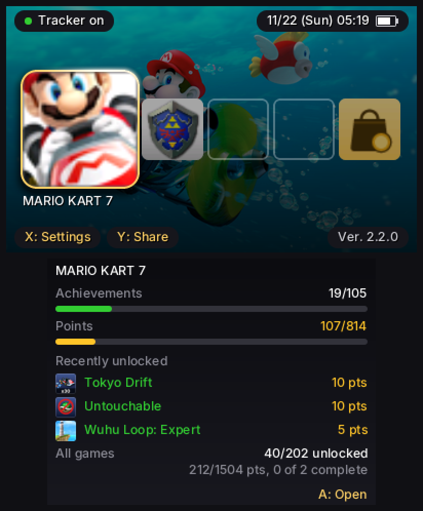
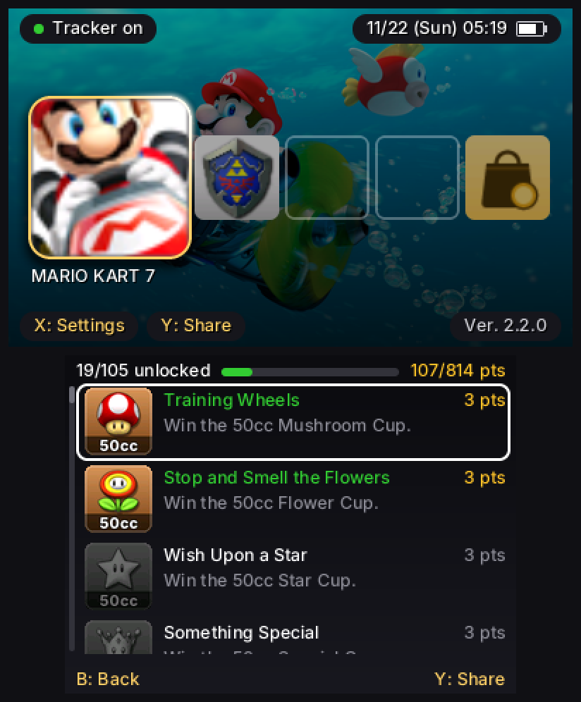
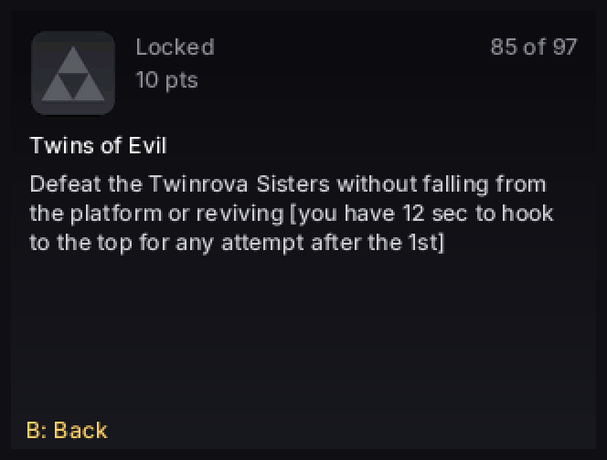
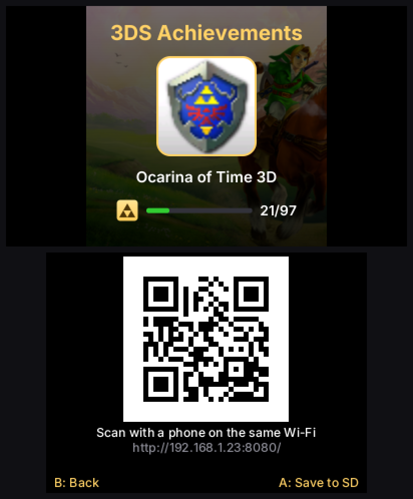
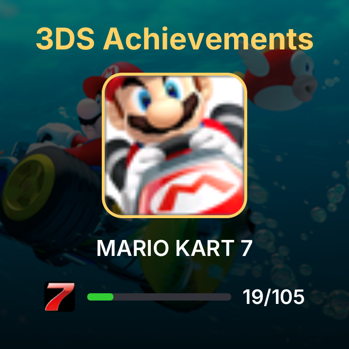
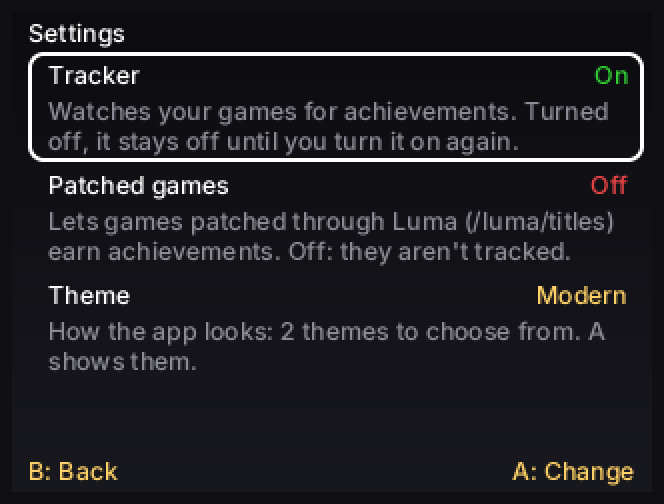
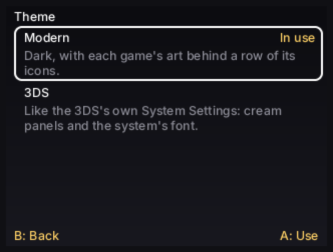
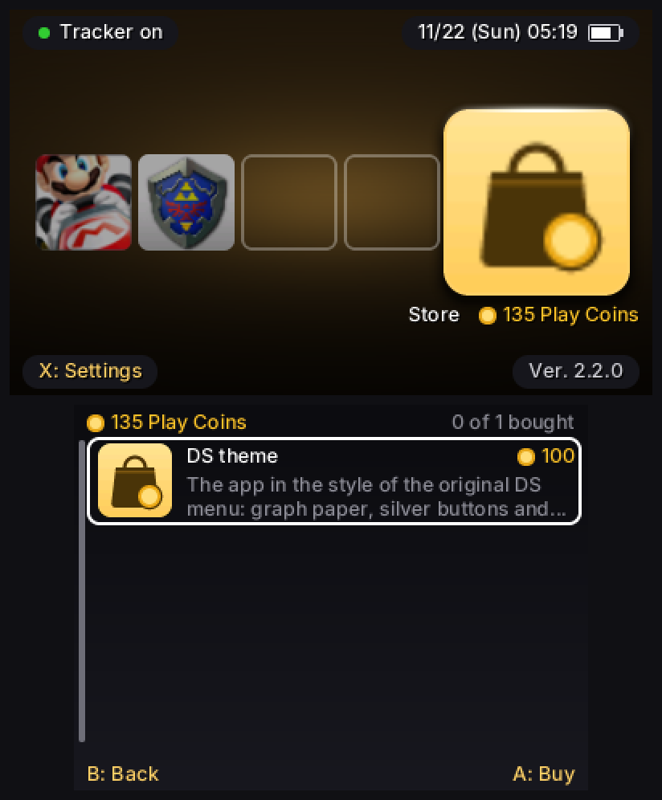
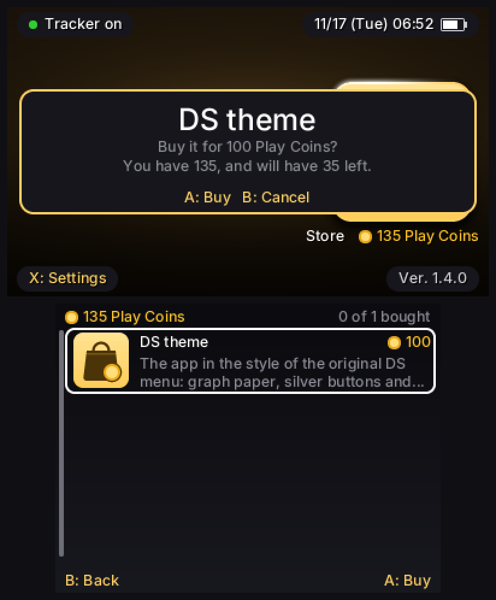

# 3DS Achievements

Achievements for Nintendo 3DS games, on real hardware with [Luma3DS](https://github.com/LumaTeam/Luma3DS).

A background module watches the running game's memory. When you earn an achievement, it saves the unlock, shows a banner on the bottom screen and turns the notification light gold. A companion app lists every game and achievement, in 3D on the top screen, downloads new ones from this repository, makes an image of your progress to share, and turns your achievement points into Play Coins to spend on new themes. Your games aren't modified.

Questions, bug reports and news: join the [Discord server](https://discord.gg/MWZKkPytYc).

| Choosing a game | Its achievements (A) |
|---|---|
|  |  |

## Supported games

- **The Legend of Zelda: Ocarina of Time 3D** (USA, EUR, JPN): 97 achievements, 690 points. All three versions share one achievement list and your progress.

This set is a port of the RetroAchievements set for the N64 original. Many of its conditions were tested with recordings and simulated play rather than a full playthrough, so some may need fixes.

## Installation

You need a 3DS with Luma3DS. The tracker relies on Luma's kernel extensions, so it doesn't run in emulators.

1. Download the zip from the [latest release](https://github.com/LiamTrader43/3ds-Achievements/releases/latest), extract it, and copy everything inside to the root of your SD card, merging with the folders already there.
2. Hold SELECT while turning on your 3DS, and in Luma's configuration turn on **Enable loading external FIRMs and modules**.
3. Install `cias/achievements.cia` with FBI to get **3DS Achievements** on the HOME Menu, or use **Achievements** in the Homebrew Launcher instead.
4. Open the app once after each boot to start the tracker. It keeps running after you leave the app. To have it start by itself whenever you turn on your 3DS, turn on **Start with the console** in the settings (see [Settings and themes](#settings-and-themes)).

Since version 1.4.0, the app updates itself. When a new release is out, it offers to download and install it (the app and the tracker) and restarts into the new version. To update by hand instead, or from an older version, copy a newer zip over the old files and restart your 3DS. Your unlocks are kept either way.

## Controls

| In the app | |
|---|---|
| Left / Right | Choose a game; the store is the last tile in the row |
| A | Open the game's achievements, or the store |
| B | Go back |
| Up / Down | Select an achievement (the list scrolls to keep it on screen) |
| Drag the touch screen | Scroll achievements |
| A, or tap an achievement | Show it in full: the whole name and description (B or a tap goes back, Up/Down show the next ones) |
| L / R | Jump a page |
| X | Settings: the tracker, starting it with the console, patched games and the theme |
| Y | Share the open game's progress (A saves the image to the SD card, B goes back) |
| 3D slider | Depth on the top screen: the game's art sits behind the screen and the selected game comes forward |
| START | Exit |

The prompts in the bottom corners of the touch screen, like **B: Back** and **A: Open**, can be tapped too. While you choose a game, the bottom screen shows how far you are in it: achievements, points, your three latest unlocks, and totals for all your games.



In a game, press **R + A + Left** to pause and see your achievements. It works like the app's list: Up/Down select an achievement, L/R (or Left/Right) jump a page, and A or a tap shows the selected one in full (B or a tap goes back). B or SELECT closes the list.

**Sharing:** with a game open, press Y to make an image of your progress in it. With the 3DS on Wi-Fi, scan the QR code on the bottom screen with a phone on the same network. A page opens with the image and a **Save image** button; on an iPhone, touch and hold the image to save it to Photos. The 3DS sends it itself, so nothing is uploaded anywhere. Press A to save the image on the SD card instead, in `/achievements/share/`.

| The share screen (Y) | The image you get |
|---|---|
|  |  |

When you open the app on Wi-Fi, it checks this repository's `main` branch and asks before downloading new games, achievements or things for the store.

Patches and mods can change how a game behaves, so while Luma's game patching is on, achievements are turned off for a game with a `code.bin`, `code.bps`, `code.ips`, `code.ups` or `romfs` folder in `/luma/titles/<TitleID>/`. The start banner tells you when this happens. To earn achievements anyway, for example with a mod you trust not to affect them, turn on **Patched games** in the settings (X). Your choice is saved, and it applies the next time you start a game.

## Settings and themes

Press X for the settings. **Tracker** turns the tracker on or off, **Patched games** is explained above, and **Theme** opens the list of themes: pick one with A and the app changes at once. Two come with the app: **Modern**, shown on this page, and **3DS**, which looks like the console's own System Settings and uses its system font. More are in the store.

| Settings (X) | Choosing a theme |
|---|---|
|  |  |

**Start with the console** starts the tracker whenever you turn on your 3DS, so you don't have to open the app first. It needs Luma3DS 13.0 or newer with a second Luma option on, **Enable game patching** (hold SELECT while turning on your 3DS); the app tells you if it's off. Be careful with game mods: with game patching on, Luma also applies any mods in `/luma/titles`. A game with mods isn't tracked while **Patched games** is off, but with it on, a mod could unlock achievements you didn't earn. The app reminds you of this before turning the setting on.

How it works: Luma starts a system module's dependencies with it, and lets a file on the SD card replace a module's list of them. So the app picks one of the system modules started at boot and writes its list, with the tracker added, to `/luma/titles/<module>/exheader.bin`. Before writing, it works out the whole boot as Luma will do it, and only uses a module where the 3DS would start normally even if the tracker couldn't start. It leaves alone the module [3DS Recorder](https://github.com/BolgarMaxym97/3ds-recorder)'s Launch On Startup uses, so both can be on. `/achievements/autostart.log` shows what it found, and `/achievements/autostart.txt` names the file. Turning the setting off removes it.

If your 3DS ever doesn't get to the HOME Menu with it on, turn it on again: the tracker notices the last start didn't finish, turns the setting off and removes the file. If that doesn't help, hold SELECT while turning on your 3DS and turn off **Enable game patching**, or delete the file named in `/achievements/autostart.txt` from the SD card. After a system update the app turns the setting off by itself, because the module it used may have changed; turn it on again to set it up for the new version.

## Play Coins and the store

Achievements earn Play Coins: 5 for every 25 points. When you open the app, it adds the coins you've earned to your 3DS's own Play Coins, the ones StreetPass Mii Plaza and other games spend. Points you earned before Play Coins were added count too. The system holds at most 300; coins past that are kept and added once you've spent some.

Spend them in the store, the last tile in the row of games. Highlight it to see your Play Coins, press A to see what's for sale, then A again to buy the selected item. A theme you buy appears in the settings' theme list. New things for the store arrive with achievement downloads, without an app update, and what you've bought is kept in `/achievements/purchases.txt` on your SD card.

| The store | Buying (A) |
|---|---|
|  |  |

## Reporting a bug

Open an [issue](https://github.com/LiamTrader43/3ds-Achievements/issues) or post in the bug report forum on [Discord](https://discord.gg/MWZKkPytYc), and **attach `/achievements/tracker.log` from your SD card**. The tracker writes it as you play: which games started, every unlock, and whether it could read the game's memory. It's usually the only way to tell what went wrong. For download problems, attach `/achievements/update.log` too, `/achievements/theme.log` if a theme won't load, and `/achievements/autostart.log` for **Start with the console**. None of these contain personal information, only game titles, unlocks and technical details. For sharing problems, attach `/achievements/share.log`; besides technical details, it lists your 3DS's and phone's addresses on your home network.

In the issue, include:

- your console (Old or New 3DS, 2DS), its system version (bottom right of System Settings) and your Luma3DS version;
- the game and its region;
- what happened and what you expected, for example the achievement that didn't unlock or unlocked too early, and roughly when.

If the console crashed with a Luma exception screen, press A to save the crash dump and attach the newest file from `/luma/dumps/arm11/`, or a photo of the screen.

You can delete `tracker.log` any time; the tracker starts a new one.

## Adding a game

Create `achievements/<TitleID>/definitions.txt`, using the game's 16-digit title ID in uppercase. Lines starting with `#` are comments.

New to finding addresses? [Finding memory addresses for 3DS achievements](docs/finding-addresses.md) walks through it, from planning a list to testing it on your 3DS.

A simple line unlocks when an address holds a value:

```
# id          address     size expected  name | description | points
FIRST_COMBO   0x0812AC10  4    3         First Combo | Land a three-hit combo. | 25
COINS_100     0x0812ABCD  2    >=100     Rich | Collect 100 coins.
```

Size is 1, 2 or 4 bytes. The name, description and points are optional, and points default to 10. Lines sharing an ID are alternatives, so whichever matches first unlocks it.

For anything more involved, use a RetroAchievements condition string. These can't unlock until the condition has been false at least once:

```
BEAT_LEVEL  rc:0xH1618fd9c=2  Level Clear | Beat the first level. | 10
```

### Plugins

Some Luma plugins change a game so much that its achievements shouldn't count, like a cheat menu or a mod that brings its own save. A line starting with `@block-plugin` turns the game's achievements off while a plugin whose file path contains the given text (any case) is running:

```
@block-plugin cheats
```

`@block-plugin *` blocks every plugin. A game can have several of these lines. The start banner says when one applies, the R + A + Left menu shows why instead of the list, and the **Patched games** setting doesn't override it. Older versions of the app and tracker skip these lines.

### Other regions

Another region (or release) of a game shares its achievements and progress. Instead of definitions, its folder holds a `version.txt` naming the game's folder:

```
# achievements/0004000000033600/version.txt: Ocarina of Time 3D (EUR)
game 0004000000033500
shift 0x0871E840 0x08724753 +0x92FD0
```

The app shows one tile for the game, and unlocks count whichever version you play. `shift` lines are optional (up to 8): each one moves the addresses in a range for this release, here a block that sits 0x92FD0 higher in the European game. Only addresses written in the definitions move. Offsets added to a pointer the game stores (`I:` in a condition) stay as written. A `version.txt` with any other kind of line isn't used, so a release that needs more than moved addresses isn't tracked with wrong ones.

A game can also have its own background and achievement icons:

```bash
python tools/hero_art.py background.png <TitleID>
python tools/trophy_art.py <TitleID> unlocked.png locked.png
```

Use a background at least 1.8 times as wide as it is tall: a little past each side of the screen comes into view with the 3D slider up.

To contribute a game, open a pull request to `main`. Players get it automatically once it's merged.

## Building

You need [devkitPro](https://devkitpro.org/) with devkitARM, libctru, `makerom` and `bannertool`, plus Python 3 with Pillow for the art tools. In devkitPro's MSYS2 shell:

```bash
pacman -S 3ds-curl 3ds-mbedtls 3ds-zlib
make -C sysmodule/tracker
make -C app cia
```

Then put the builds in `sysmodule/dist`, which mirrors the SD card:

```bash
cp sysmodule/tracker/tracker.cxi sysmodule/dist/luma/sysmodules/0004013000AC4102.cxi
cp app/achievements-viewer.cia sysmodule/dist/cias/achievements.cia
cp app/achievements-viewer.3dsx sysmodule/dist/3ds/achievements-viewer.3dsx
python tools/make_versions.py
```

The store's files in `achievements/store/` are encrypted, and only builds made with the project's private key can open them, so the store is empty in your own builds.

## Credits

**Collaborators:** Swamp Puppy (UI design)

**Code**

- [rcheevos](https://github.com/RetroAchievements/rcheevos) v12.5.0, Copyright (c) 2018 RetroAchievements.org (MIT): achievement conditions
- [libctru](https://github.com/devkitPro/libctru) and devkitPro (zlib): 3DS system library and toolchain
- [curl](https://curl.se/), Copyright (c) 1996 - 2023 Daniel Stenberg and contributors (curl license): downloads
- [Mbed TLS](https://github.com/Mbed-TLS/mbedtls) (Apache-2.0): HTTPS
- [zlib](https://zlib.net/) (zlib): compression for curl and the share image
- [QR Code generator library](https://www.nayuki.io/page/qr-code-generator-library) v1.8.0, Copyright (c) Project Nayuki (MIT): the share screen's QR code

**Fonts:** [Inter](https://rsms.me/inter/), Copyright 2016 The Inter Project Authors (SIL Open Font License 1.1, see [assets/fonts/OFL.txt](assets/fonts/OFL.txt)): the Modern theme, the banner, the in-game list and the share image. The 3DS theme uses the console's own system font, read from the 3DS; none of it comes with the app.

**Achievements:** the Ocarina of Time 3D names, descriptions and points come from the community's [RetroAchievements set](https://retroachievements.org/game/10113). The conditions were rewritten for the 3DS version.

**Research:** [zeldaret/oot](https://github.com/zeldaret/oot), the OoT3D Randomizer project, and [OcarinaCTRComposer](https://github.com/samaBR85/OcarinaCTRComposer).

**Art and sound:** game icons, titles, character art and the Triforce belong to Nintendo. The logo and banner sound were made for this project.

## License

GPLv3; see [LICENSE](LICENSE). Bundled third-party code keeps its own license.

This is an unofficial fan project, not affiliated with or endorsed by Nintendo or RetroAchievements. Unlocks stay on your SD card and don't appear on a RetroAchievements profile. Nintendo 3DS, The Legend of Zelda and Ocarina of Time are trademarks of Nintendo.
