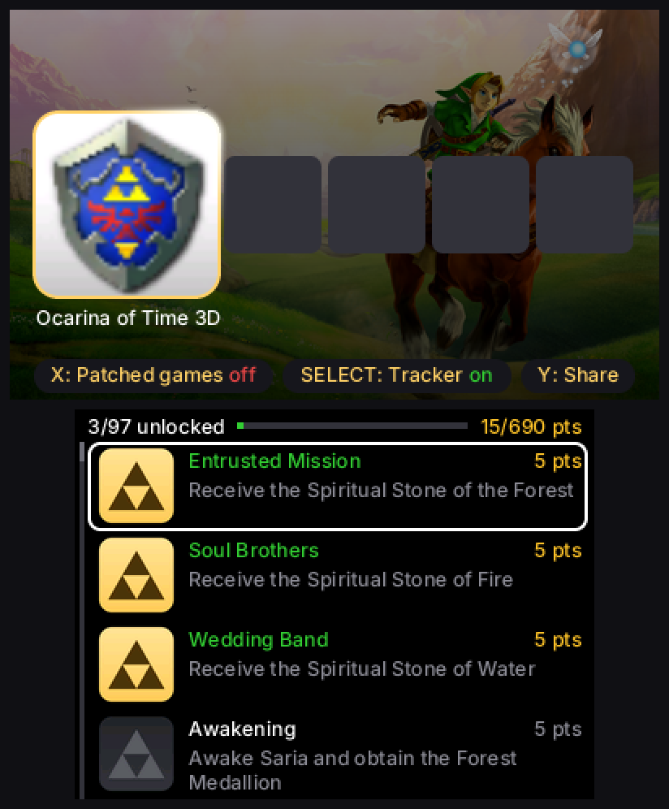
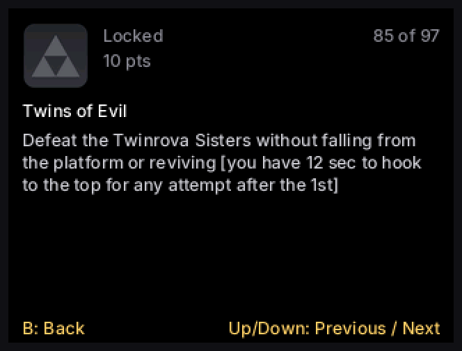
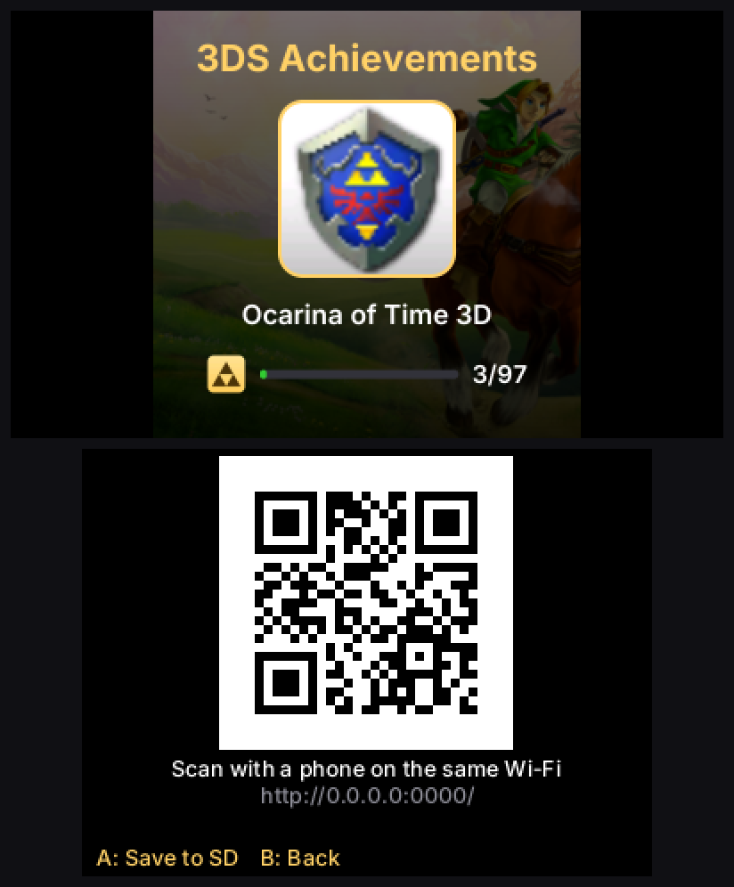
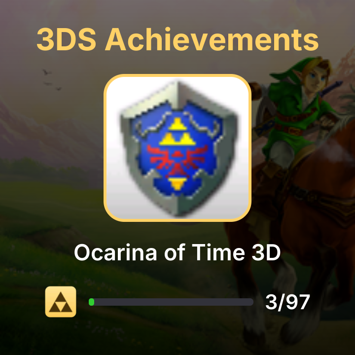

# 3DS Achievements

Achievements for Nintendo 3DS games, on real hardware with [Luma3DS](https://github.com/LumaTeam/Luma3DS).

A background module watches the running game's memory. When you earn an achievement, it saves the unlock, shows a banner on the bottom screen and turns the notification light gold. A companion app lists every game and achievement, downloads new ones from this repository, and makes an image of your progress to share. Your games aren't modified.

| The app | One achievement in full (A) |
|---|---|
|  |  |

## Supported games

- **The Legend of Zelda: Ocarina of Time 3D** (USA, EUR, JPN): 97 achievements, 690 points. All three versions share one achievement list and your progress.

This set is a port of the RetroAchievements set for the N64 original. Many of its conditions were tested with recordings and simulated play rather than a full playthrough, so some may need fixes.

## Installation

You need a 3DS with Luma3DS. The tracker relies on Luma's kernel extensions, so it doesn't run in emulators.

1. Download the zip from the [latest release](https://github.com/LiamTrader43/3ds-Achievements/releases/latest), extract it, and copy everything inside to the root of your SD card, merging with the folders already there.
2. Hold SELECT while turning on your 3DS, and in Luma's configuration turn on **Enable loading external FIRMs and modules**.
3. Install `cias/achievements.cia` with FBI to get **3DS Achievements** on the HOME Menu, or use **Achievements** in the Homebrew Launcher instead.
4. Open the app once after each boot to start the tracker. It keeps running after you leave the app.

To update, copy a newer zip over the old files. Your unlocks are kept.

## Controls

| In the app | |
|---|---|
| Left / Right | Change game |
| Up / Down | Select an achievement (the list scrolls to keep it on screen) |
| Drag the touch screen | Scroll achievements |
| A, or tap an achievement | Show it in full: the whole name and description (B or a tap goes back, Up/Down show the next ones) |
| L / R | Jump a page |
| SELECT | Turn the tracker on or off |
| X | Allow or block achievements in patched games |
| Y | Share the selected game's progress (A saves the image to the SD card, B goes back) |
| START | Exit |

In a game, press **R + A + Left** to pause and see your achievements. It works like the app's list: Up/Down select an achievement, L/R (or Left/Right) jump a page, and A or a tap shows the selected one in full (B or a tap goes back). B or SELECT closes the list.

**Sharing:** press Y to make an image of the selected game's progress. With the 3DS on Wi-Fi, scan the QR code on the bottom screen with a phone on the same network. A page opens with the image and a **Save image** button; on an iPhone, touch and hold the image to save it to Photos. The 3DS sends it itself, so nothing is uploaded anywhere. Press A to save the image on the SD card instead, in `/achievements/share/`.

| The share screen (Y) | The image you get |
|---|---|
|  |  |

When you open the app on Wi-Fi, it checks this repository's `main` branch and asks before downloading new games or achievements.

Patches and mods can change how a game behaves, so while Luma's game patching is on, achievements are turned off for a game with a `code.bin`, `code.bps`, `code.ips`, `code.ups` or `romfs` folder in `/luma/titles/<TitleID>/`. The start banner tells you when this happens. To earn achievements anyway, for example with a mod you trust not to affect them, press X in the app to turn on **Patched games**. Your choice is saved, and it applies the next time you start a game.

## Reporting a bug

Open an [issue](https://github.com/LiamTrader43/3ds-Achievements/issues) and **attach `/achievements/tracker.log` from your SD card**. The tracker writes it as you play: which games started, every unlock, and whether it could read the game's memory. It's usually the only way to tell what went wrong. For download problems, attach `/achievements/update.log` too. Neither contains personal information, only game titles, unlocks and technical details. For sharing problems, attach `/achievements/share.log`; besides technical details, it lists your 3DS's and phone's addresses on your home network.

In the issue, include:

- your console (Old or New 3DS, 2DS), its system version (bottom right of System Settings) and your Luma3DS version;
- the game and its region;
- what happened and what you expected, for example the achievement that didn't unlock or unlocked too early, and roughly when.

If the console crashed with a Luma exception screen, press A to save the crash dump and attach the newest file from `/luma/dumps/arm11/`, or a photo of the screen.

You can delete `tracker.log` any time; the tracker starts a new one.

## Adding a game

Create `achievements/<TitleID>/definitions.txt`, using the game's 16-digit title ID in uppercase. Lines starting with `#` are comments.

A simple line unlocks when an address holds a value:

```
# id          address     size expected  name | description | points
FIRST_COMBO   0x0812AC10  4    3         First Combo | Land a three-hit combo. | 25
COINS_100     0x0812ABCD  2    >=100     Rich | Collect 100 coins.
```

Size is 1, 2 or 4 bytes. The name, description and points are optional, and points default to 10. Lines sharing an ID are alternatives, so whichever matches first unlocks it.

For anything more involved, use a RetroAchievements condition string. These can't unlock until the condition has been false at least once:

```
BEAT_LEVEL  rc:0xH1618fd9c=2  Level Clear | Beat the first level. | 10
```

### Other regions

Another region (or release) of a game shares its achievements and progress. Instead of definitions, its folder holds a `version.txt` naming the game's folder:

```
# achievements/0004000000033600/version.txt: Ocarina of Time 3D (EUR)
game 0004000000033500
shift 0x0871E840 0x08724753 +0x92FD0
```

The app shows one tile for the game, and unlocks count whichever version you play. `shift` lines are optional (up to 8): each one moves the addresses in a range for this release, here a block that sits 0x92FD0 higher in the European game. Only addresses written in the definitions move. Offsets added to a pointer the game stores (`I:` in a condition) stay as written. A `version.txt` with any other kind of line isn't used, so a release that needs more than moved addresses isn't tracked with wrong ones.

A game can also have its own background and achievement icons:

```bash
python tools/hero_art.py background.png <TitleID>
python tools/trophy_art.py <TitleID> unlocked.png locked.png
```

To contribute a game, open a pull request to `main`. Players get it automatically once it's merged.

## Building

You need [devkitPro](https://devkitpro.org/) with devkitARM, libctru, `makerom` and `bannertool`, plus Python 3 with Pillow for the art tools. In devkitPro's MSYS2 shell:

```bash
pacman -S 3ds-curl 3ds-mbedtls 3ds-zlib
make -C sysmodule/tracker
make -C app cia
```

Then put the builds in `sysmodule/dist`, which mirrors the SD card:

```bash
cp sysmodule/tracker/tracker.cxi sysmodule/dist/luma/sysmodules/0004013000AC4102.cxi
cp app/achievements-viewer.cia sysmodule/dist/cias/achievements.cia
cp app/achievements-viewer.3dsx sysmodule/dist/3ds/achievements-viewer.3dsx
python tools/make_versions.py
```

## Credits

**Collaborators:** Swamp Puppy (UI design)

**Code**

- [rcheevos](https://github.com/RetroAchievements/rcheevos) v12.5.0, Copyright (c) 2018 RetroAchievements.org (MIT): achievement conditions
- [libctru](https://github.com/devkitPro/libctru) and devkitPro (zlib): 3DS system library and toolchain
- [curl](https://curl.se/), Copyright (c) 1996 - 2023 Daniel Stenberg and contributors (curl license): downloads
- [Mbed TLS](https://github.com/Mbed-TLS/mbedtls) (Apache-2.0): HTTPS
- [zlib](https://zlib.net/) (zlib): compression for curl and the share image
- [QR Code generator library](https://www.nayuki.io/page/qr-code-generator-library) v1.8.0, Copyright (c) Project Nayuki (MIT): the share screen's QR code

**Font:** [Inter](https://rsms.me/inter/), Copyright 2016 The Inter Project Authors (SIL Open Font License 1.1, see [assets/fonts/OFL.txt](assets/fonts/OFL.txt)): all text in the app, the banner, the in-game list and the share image.

**Achievements:** the Ocarina of Time 3D names, descriptions and points come from the community's [RetroAchievements set](https://retroachievements.org/game/10113). The conditions were rewritten for the 3DS version.

**Research:** [zeldaret/oot](https://github.com/zeldaret/oot), the OoT3D Randomizer project, and [OcarinaCTRComposer](https://github.com/samaBR85/OcarinaCTRComposer).

**Art and sound:** game icons, titles, character art and the Triforce belong to Nintendo. The logo and banner sound were made for this project.

## License

GPLv3; see [LICENSE](LICENSE). Bundled third-party code keeps its own license.

This is an unofficial fan project, not affiliated with or endorsed by Nintendo or RetroAchievements. Unlocks stay on your SD card and don't appear on a RetroAchievements profile. Nintendo 3DS, The Legend of Zelda and Ocarina of Time are trademarks of Nintendo.
