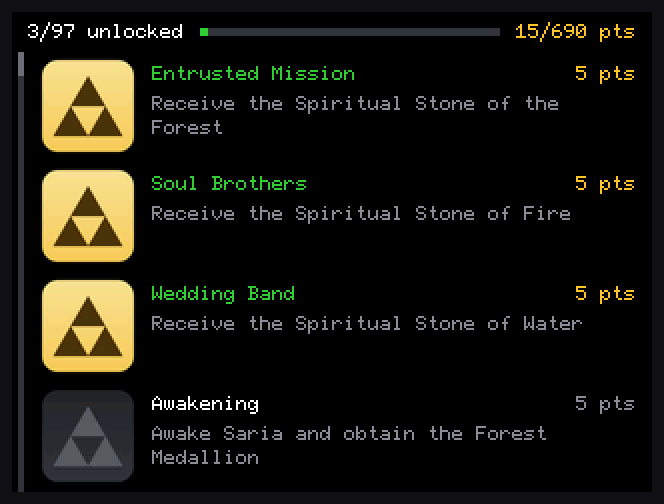

# 3DS Achievements

Achievements for Nintendo 3DS games, on real hardware with [Luma3DS](https://github.com/LumaTeam/Luma3DS).

A background module watches the running game's memory. When you earn an achievement, it saves the unlock, shows a banner on the bottom screen and turns the notification light gold. A companion app lists every game and achievement, and downloads new ones from this repository. Your games aren't modified.

| The app | In-game (R + A + Left) |
|---|---|
|  |  |

## Supported games

- **The Legend of Zelda: Ocarina of Time 3D** (USA): 97 achievements, 690 points

This set is a port of the RetroAchievements set for the N64 original. Many of its conditions were tested with recordings and simulated play rather than a full playthrough, so some may need fixes.

## Installation

You need a 3DS with Luma3DS. The tracker relies on Luma's kernel extensions, so it doesn't run in emulators.

1. Download the zip from the [latest release](https://github.com/LiamTrader43/3ds-Achievements/releases/latest), extract it, and copy everything inside to the root of your SD card, merging with the folders already there.
2. Hold SELECT while turning on your 3DS, and in Luma's configuration turn on **Enable loading external FIRMs and modules**.
3. Install `cias/achievements.cia` with FBI, or use **3DS Achievements** in the Homebrew Launcher instead.
4. Open **3DS Achievements** once after each boot to start the tracker. It keeps running after you leave the app.

To update, copy a newer zip over the old files. Your unlocks are kept.

## Controls

| In the app | |
|---|---|
| Left / Right | Change game |
| Up / Down, or drag the touch screen | Scroll achievements |
| L / R | Jump a page |
| SELECT | Turn the tracker on or off |
| START | Exit |

In a game, press **R + A + Left** to pause and see your achievements. B or SELECT closes the list.

When you open the app on Wi-Fi, it checks this repository's `main` branch and asks before downloading new games or achievements.

## Adding a game

Create `achievements/<TitleID>/definitions.txt`, using the game's 16-digit title ID in uppercase. Lines starting with `#` are comments.

A simple line unlocks when an address holds a value:

```
# id          address     size expected  name | description | points
FIRST_COMBO   0x0812AC10  4    3         First Combo | Land a three-hit combo. | 25
COINS_100     0x0812ABCD  2    >=100     Rich | Collect 100 coins.
```

Size is 1, 2 or 4 bytes. The name, description and points are optional, and points default to 10. Lines sharing an ID are alternatives, so whichever matches first unlocks it.

For anything more involved, use a RetroAchievements condition string. These can't unlock until the condition has been false at least once:

```
BEAT_LEVEL  rc:0xH1618fd9c=2  Level Clear | Beat the first level. | 10
```

A game can also have its own background and achievement icons:

```bash
python tools/hero_art.py background.png <TitleID>
python tools/trophy_art.py <TitleID> unlocked.png locked.png
```

To contribute a game, open a pull request to `main`. Players get it automatically once it's merged.

## Building

You need [devkitPro](https://devkitpro.org/) with devkitARM, libctru, `makerom` and `bannertool`, plus Python 3 with Pillow for the art tools. In devkitPro's MSYS2 shell:

```bash
pacman -S 3ds-curl 3ds-mbedtls 3ds-zlib
make -C sysmodule/tracker
make -C app cia
```

Then put the builds in `sysmodule/dist`, which mirrors the SD card:

```bash
cp sysmodule/tracker/tracker.cxi sysmodule/dist/luma/sysmodules/0004013000AC4102.cxi
cp app/achievements-viewer.cia sysmodule/dist/cias/achievements.cia
cp app/achievements-viewer.3dsx sysmodule/dist/3ds/achievements-viewer.3dsx
python tools/make_versions.py
```

## Credits

**Code**

- [rcheevos](https://github.com/RetroAchievements/rcheevos) v12.5.0, Copyright (c) 2018 RetroAchievements.org (MIT): achievement conditions
- [Luma3DS](https://github.com/LumaTeam/Luma3DS) (GPLv3): the 6x10 font from Rosalina
- [libctru](https://github.com/devkitPro/libctru) and devkitPro (zlib): 3DS system library and toolchain
- [curl](https://curl.se/), Copyright (c) 1996 - 2023 Daniel Stenberg and contributors (curl license): downloads
- [Mbed TLS](https://github.com/Mbed-TLS/mbedtls) (Apache-2.0): HTTPS
- [zlib](https://zlib.net/) (zlib): compression for curl

**Achievements:** the Ocarina of Time 3D names, descriptions and points come from the community's [RetroAchievements set](https://retroachievements.org/game/10113). The conditions were rewritten for the 3DS version.

**Research:** [zeldaret/oot](https://github.com/zeldaret/oot), the OoT3D Randomizer project, and [OcarinaCTRComposer](https://github.com/samaBR85/OcarinaCTRComposer).

**Art and sound:** game icons, titles, character art and the Triforce belong to Nintendo. The logo and banner sound were made for this project.

## License

GPLv3; see [LICENSE](LICENSE). Bundled third-party code keeps its own license.

This is an unofficial fan project, not affiliated with or endorsed by Nintendo or RetroAchievements. Unlocks stay on your SD card and don't appear on a RetroAchievements profile. Nintendo 3DS, The Legend of Zelda and Ocarina of Time are trademarks of Nintendo.
